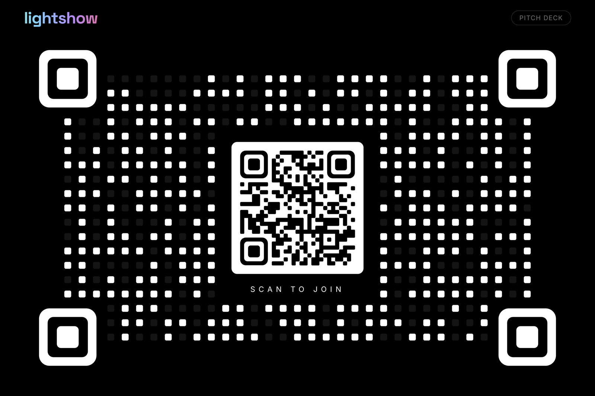
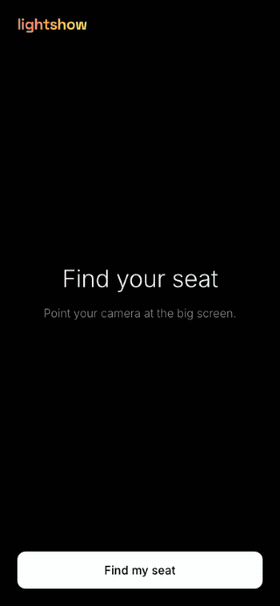
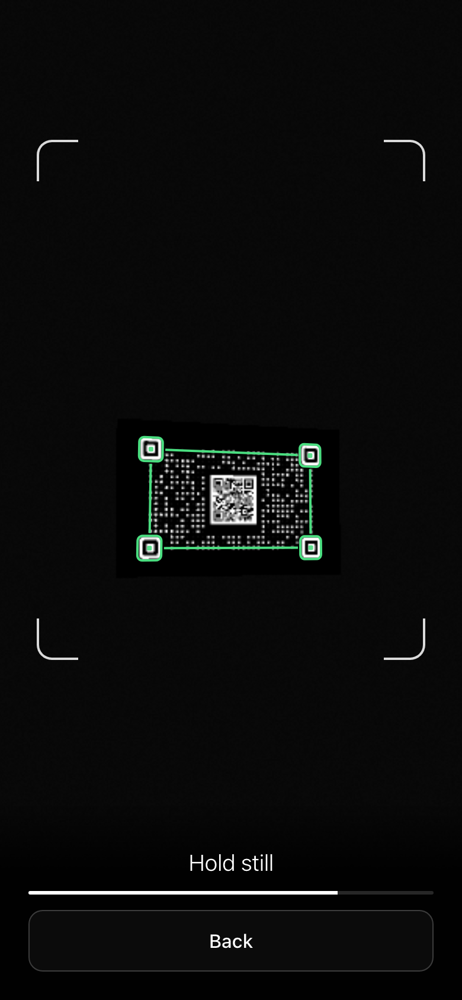
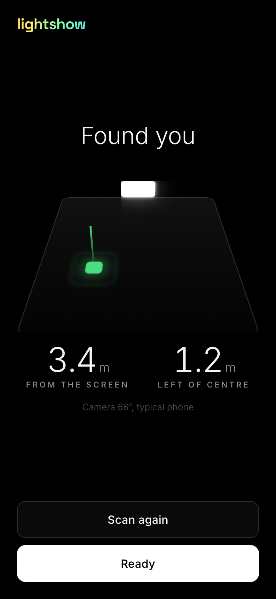
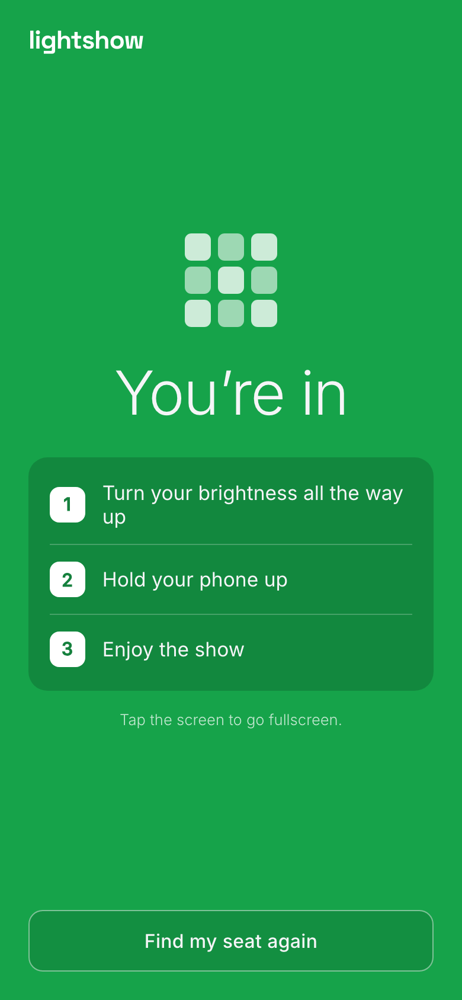

# lightshow

Turn an audience's phones into a synchronised crowd light show. No app install or hardware wristbands required.

A host draws the venue, drops in an audio track and paints light effects onto a timeline, or generates a full show from the music. At the event, participants scan a QR code on the big screen, point their phone camera at the screen to locate their seat, and play back their pre-computed light schedule in sync over WebSockets.

[Visit lightshow.party](https://lightshow.party)

[](docs/media/editor.png)

Built for the **2026 Tanda Hackathon**.

| Team                                                             | Contribution                                                                |
| ---------------------------------------------------------------- | --------------------------------------------------------------------------- |
| Etao · [@wetsocksnsleeves](https://github.com/wetsocksnsleeves)  | Sync engine, schedule compiler, audio-reactive generator and built-in shows |
| William · [@williamjaackson](https://github.com/williamjaackson) | Camera seat positioning, rooms editor and crowd recording                   |
| Chloe · [@clobothehobo](https://github.com/clobothehobo)         | Host room design, branding and built-in tracks                              |
| Lliam · [@lliamsymonds04](https://github.com/lliamsymonds04)     | 3D crowd viewer and Fly.io deployment                                       |
| Farzad · [@FarzadHayat](https://github.com/FarzadHayat)          | Pitch deck stage lighting and demo show                                     |

## Big screen QR code and camera seat finding

Every audience phone needs to know where it is in the room without typing a row or seat number. The big screen (`/sessions/<code>/screen`) handles both joining and positioning in one view:

- **Join QR code** in the centre opens the participant page straight in the phone's browser.
- **Four corner anchors** (rounded finder squares) let the phone's camera lock onto the screen from anywhere in the room.
- **Rotation-unique LED grille** (~300 lit and unlit dots) identifies each corner regardless of phone orientation and gives hundreds of matched points to solve the camera's 3D position in metres.

After scanning the QR code, a participant taps **Find my seat**, points their phone back at the big screen for a second until the green lock completes, checks their spot on the room map, and taps **Ready**. The phone then enters fullscreen, requests a wake lock, runs a clock-sync handshake over WebSockets, and downloads its own pre-computed light schedule.

<table>
  <tr>
    <td width="72%"><a href="docs/media/big-screen.png"></a></td>
    <td width="28%"><a href="docs/demo/phone-setup.gif"></a></td>
  </tr>
</table>

Point at the big screen → seat solved in metres → synced and ready.

<p>
  <a href="docs/media/phone-scan.png"></a>
  <a href="docs/media/phone-found.png"></a>
  <a href="docs/media/phone-ready.png"></a>
</p>

## Studio and 3D preview

Layer flashes, waves, splits, chases and custom shapes over an audio waveform, or auto-generate a show from three-band frequency analysis. Before showtime, open `/mock` to simulate a crowd joining and watch the whole venue play back in 3D.

| Editor and multi-track timeline                                        | Simulated phones joining a room                                                                     |
| ---------------------------------------------------------------------- | --------------------------------------------------------------------------------------------------- |
| [](docs/demo/editor-view.gif) | [](docs/demo/mock-demo-join.gif) |

| Live playback from the host room                                                                      | Bird's-eye 3D crowd view                                                                        |
| ----------------------------------------------------------------------------------------------------- | ----------------------------------------------------------------------------------------------- |
| [](docs/demo/live-show-editor.gif) | [](docs/demo/mock-3d-live.gif) |

## Run locally

Built with Next.js, TypeScript, Node.js (`ws`) and SQLite. Requires Node.js 24+.

```sh
git clone https://github.com/wetsocksnsleeves/lightshow.git
cd lightshow
npm ci
npm run dev
```

Open [localhost:3000](http://localhost:3000) to open a host room, then open [localhost:3000/mock](http://localhost:3000/mock) in another tab to simulate phones joining in 3D.

To test with real phones over HTTPS (required for camera access and screen wake lock), copy `.env.example` to `.env` and set `PUBLIC_URL` to your tunnel or public HTTPS address.

[Spec](SPEC.md) · [Development plan](DEVELOPMENT.md) · [Device testing](docs/device-test.md)

## License

[O'Saasy License](LICENSE.md)
