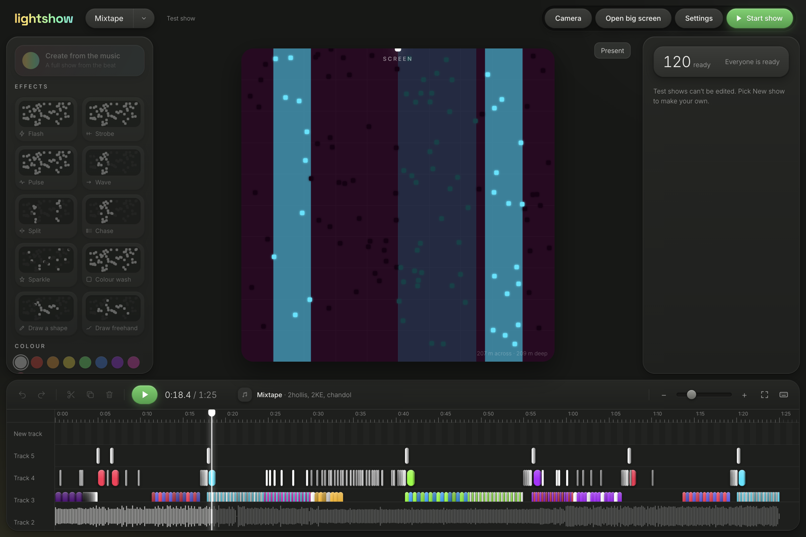

# Lightshow

Turn an audience's phones into a synchronised crowd light show. No app install or hardware wristbands required.

A host draws the venue, drops in an audio track and paints light effects onto a timeline, or generates a full show from the music. At the event, participants scan a QR code on the big screen, point their phone camera at the screen to locate their seat, and play back their pre-computed light schedule in sync over WebSockets.

[Visit lightshow.party](https://lightshow.party)

[](docs/media/editor.png)

Built for the **2026 Tanda Hackathon**.

| Team                                                             | Contribution                                                                |
| ---------------------------------------------------------------- | --------------------------------------------------------------------------- |
| Etao · [@wetsocksnsleeves](https://github.com/wetsocksnsleeves)  | Sync engine, schedule compiler, audio-reactive generator and built-in shows |
| William · [@williamjaackson](https://github.com/williamjaackson) | Camera seat positioning, rooms editor and crowd recording                   |
| Chloe · [@clobothehobo](https://github.com/clobothehobo)         | Host room design, branding and built-in tracks                              |
| Lliam · [@lliamsymonds04](https://github.com/lliamsymonds04)     | 3D crowd viewer and Fly.io deployment                                       |
| Farzad · [@FarzadHayat](https://github.com/FarzadHayat)          | Pitch deck stage lighting and demo show                                     |

## How it works

1. **Design the show** in the host room — layer flashes, waves, splits, chases and custom shapes over an audio waveform, or auto-generate a show from three-band frequency analysis.
2. **Project the big screen** (`/sessions/<code>/screen`) with its corner positioning anchors, LED grille and join QR code.
3. **Locate seats with the camera** — each phone scans the QR code, points at the big screen to solve its position in the room, syncs its clock to the server, and receives its own light schedule.
4. **Preview and run live** — simulate a crowd in 3D at `/mock` before showtime, then start playback in sync with the venue's audio.

[](docs/media/big-screen.png)

## Demo

| Editor and multi-track timeline                                        | Simulated phones joining a room                                                                     |
| ---------------------------------------------------------------------- | --------------------------------------------------------------------------------------------------- |
| [](docs/demo/editor-view.gif) | [](docs/demo/mock-demo-join.gif) |

| Live playback from the host room                                                                      | Bird's-eye 3D crowd view                                                                        |
| ----------------------------------------------------------------------------------------------------- | ----------------------------------------------------------------------------------------------- |
| [](docs/demo/live-show-editor.gif) | [](docs/demo/mock-3d-live.gif) |

## Run locally

Built with Next.js, TypeScript, Node.js (`ws`) and SQLite. Requires Node.js 24+.

```sh
git clone https://github.com/wetsocksnsleeves/lightshow.git
cd lightshow
npm ci
npm run dev
```

Open [localhost:3000](http://localhost:3000) to open a host room, then open [localhost:3000/mock](http://localhost:3000/mock) in another tab to simulate phones joining in 3D.

To test with real phones over HTTPS (required for camera access and screen wake lock), copy `.env.example` to `.env` and set `PUBLIC_URL` to your tunnel or public HTTPS address.

[Spec](SPEC.md) · [Development plan](DEVELOPMENT.md) · [Device testing](docs/device-test.md)

## License

[O'Saasy License](LICENSE.md)
